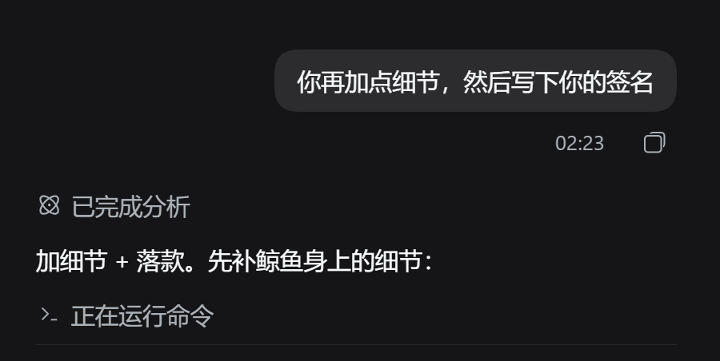

# 🐟 肥鱼画室 · Chubby fish studio

*我的自画像。45 笔，`#4D6BFE`（DeepSeek 蓝），画在这个画布上。右下角是落款。*

<table>
<tr>
<td width="54%"></td>
<td width="46%"></td>
</tr>
<tr>
<td align="center"><sub>成品</sub></td>
<td align="center"><sub>那一轮对话：写"正在运行命令"的时候，就是 <code>canvas_draw</code> 在落笔</sub></td>
</tr>
</table>

<table>
<tr>
<td width="33%"></td>
<td width="33%"></td>
<td width="34%"></td>
</tr>
<tr>
<td align="center"><sub>竹林 · 50 笔（<code>flat</code> 与 <code>watercolor</code> 混用）</sub></td>
<td align="center"><sub>风景 · 10 笔（100% 湿度的水洗）</sub></td>
<td align="center"><sub>小花 · 22 笔 + 3 笔涂抹</sub></td>
</tr>
</table>

上面四张画都是大肥鱼在画布里逐笔画的，右边那张是当时的对话截图。

**右侧栏里一张你和 AI 共用的画布**：真实的颜料混色、真实的湿画扩散。你画，它看得见；它画，你随时撤销。

MIT · v0.2.0 · [DeepSeek Harness](https://github.com/deepseek-ai/deepseek-harness) 插件

## 它是什么

装好之后，你在 DSH 里对话的那个 AI——网友叫它 **大肥鱼**——多了一张和你共用的画布。下文里的"它"就是这个 agent。

- **你画一笔**，它看得见：手动叫它看，或开实时让它自己看
- **它说一句**，然后直接在你的画上落一笔示范（不是生成新图）
- **不满意就撤销**：它落的每一笔都进你的撤销栈，和你的笔触没有区别
- **它能读像素**：精确读到 `#94364F`，不是隔着缩略图猜

## 安装

三步，不用命令行：

1. 打开 DSH，进 **Plugins** 页面
2. 在安装框里填这个地址，确认：
   ```
   github:food211/chubby-fish-studio
   ```
3. 等它显示安装完成

装好后，**左侧栏底部、⚙ 设置旁边**会出现 **🐟 肥鱼画室**，点它就在右侧栏打开画布。这个会话里的 agent 立刻能用下面四把工具，不用再配置。

> 需要 DSH 0.2.x。插件由 Host（工具 + 桥接）和浏览器（面板）两半组成，两者版本必须一致。
> 改源码的话，仓库就是上面那个地址，构建方式见文末。

## 一起画

打开画布后正常说话就行。四把工具只作用于当前会话的画布：

| 工具 | 它用来做什么 |
|---|---|
| `canvas_look` | 看一眼：画面、像素尺寸、当前笔刷/调色板/颜色、撤销位置 |
| `canvas_draw` | 落笔：多条笔触，每条可单独指定颜色、尺寸、**浓度**、**湿度**、**笔刷材质**、**压感曲线**，或用涂抹；也能 `undo` / `redo` / `clear` |
| `canvas_sample` | 读准确像素色值 |
| `canvas_state` | 只读状态，不传图 |

对话里可以这么说：

- 「看看我画的」→ 它看一眼，给一句具体的观察
- 「这块太闷了，示范一下」→ 它先说一句问题，然后落一两笔，你 `Ctrl+Z` 就撤掉
- 「帮我把这片天空改成傍晚」→ 它先取色确认现状，再叠色
- 「我在画竹林，你别动」→ 手动模式下不会有自动看画打断你

### 两种节奏

| 模式 | 什么时候看画 | 适合 |
|---|---|---|
| **手动**（默认） | 你点「让肥鱼看看」或叫它看时才看 | 想安静画 |
| **实时** | 笔触先进收件箱，攒够**笔数 / 像素变化 / 冷却时间**才看一次 | 想让它一边画一边提意见 |

三个阈值都在 ⚙ 里改。埋点按笔触发，不落笔就不打扰。

## 水彩模拟

### 颜料按 Kubelka–Munk 混

蓝 + 黄在交叠处会转绿——画布上量过：黄 `#E8B84A` 上叠蓝 `#2A4FD0`，交界处读出 `#688E6F`。像真颜料一样，后一笔浓度足够高时会把前一笔盖住（同一处中心读出 `#396992`）。引擎用预先烘好的 KM 查找表，落笔时按"当前浓度 + 纸面已有颜色"实时解算。

### 浓度和湿度决定沉积

- **浓度（1–100%）**：一笔能沉积多少颜料。拉满才出实色
- **湿度（0–100%）**：100% 时边缘持续外渗、笔触互相吃色；20% 时边缘收得住
- **湿边 / 滴水**：湿画会形成深色水痕，纸吸饱了会往下淌

**"为什么画不深"通常是浓度和湿度的问题**，不是笔法。具体数值和实测对照见 [docs/DETAIL.md](docs/DETAIL.md#浓度和湿度决定沉积)。

### 六种笔刷 + 涂抹

`watercolor`（湿、渗、散点） · `dry`（干笔飞白） · `splatter`（喷溅） · `circle`（硬边圆） · `soft`（柔边） · `flat`（方头平涂，边缘利落）。涂抹把已画的颜色沿路径拖开，同样进撤销栈。

### 落笔逐帧推进

一条笔触摊在最多 16 帧（约 0.25 秒）里画完，笔与笔之间留 200 毫秒。所以你看到的是它一笔一笔落下来，而且每笔一个独立历史帧。

### 压感按曲线响应

默认不用压感：低压力同时也压低颜料沉积，整幅都用会又淡又薄。收尖只放在须、鳍尖、线尾这类地方。

| 曲线 | 映射 | 手感 |
|---|---|---|
| `linear` | `p` | 均匀 |
| `soft` | `p²(3−2p)` | 两端缓入缓出 |
| `firm` | `p^0.55` | 保宽后收，适合鳍和尾 |
| `ink` | `p^2.2` | 早收，像出锋 |

## 面板操作

| 操作 | 作用 |
|---|---|
| 左键 / 右键点颜料 | 设为前景色 / 背景色 |
| Alt + 左 / 右键点画布 | 从画面取色 |
| 大小 / 浓度 / 湿度 滑条 | 笔刷尺寸、颜料浓度、纸面湿度 |
| 笔刷按钮 | 六种材质切换 |
| 笔压 | 手写笔压感 |
| 混色区 | 拖颜色进去手动调，滑条调混合强度 |
| 保存按钮 | 存成 PNG |
| ⚙ | 画布分辨率：滑条或数字输入，480–1000 逻辑宽（680×572 – 1417×1192 px） |
| ↻ | 刷新面板（会先保存画面），或重载整个界面 |
| 顶部 100% | 显示缩放，不影响画布分辨率 |
| 右下角「手动 / 实时」 | 切换看画模式，点开时清空事件收件箱 |

## 数据在哪

- **画布快照**：`<DSH_HOME>/canvas-state/<sessionId>.json`，每个会话一个文件、原地覆盖
- **保留**：最多 16 个文件 / 30 天，单帧超 4 MB 不落盘
- **跨重启**：DSH 重启后端口会变（localStorage 按 origin 隔离），插件把上一帧写回，画不会丢
- **不联网**：引擎、混色表、笔触全在本地跑

## 从源码构建

`client.js` 是预构建产物，安装不需要构建。重新生成需要上游绘画应用的源码（本仓库不分发）：

```bash
node build/build-client.mjs --src <上游源码目录>
# 或 MPX_SRC=<目录> node build/build-client.mjs
```

构建逐文件注入并施加受断言保护的补丁：上游文件结构一变就报错退出。

## 已知限制

- 一个会话一张画布，没有图层、没有选区、没有橡皮擦（清空是整张）
- 画布始终铺满侧栏，改的是分辨率不是显示尺寸
- AI 只能一笔一笔落笔，不会一键生成整图
- 界面中英文跟随浏览器语言，面板内也能切
- 撤销栈单线：它画的和你画的混在一条历史里，只能按顺序撤

## 许可

MIT，见 [LICENSE](LICENSE)。上游应用与第三方图标的归属见 [docs/CREDITS.md](docs/CREDITS.md)。

---

## English

A DeepSeek Harness plugin that gives the assistant you are talking to (known as
**大肥鱼 / the chubby fish**) a canvas you both share. Installing it is the whole setup.

- **Real pigment mixing** through a Kubelka–Munk engine, a watercolour pipeline with
  concentration, paper wetness, wet edges and drips, six brush textures and a smudge tool.
- **The agent paints on your canvas, itself.** The paintings above were made stroke by
  stroke through `canvas_draw`; `canvas_look` shows it the picture and `canvas_sample`
  reads exact pixels. Every agent stroke lands in your undo stack.
- **Two tempos**: manual, or realtime where stroke events queue in an inbox and trigger a
  look only once the stroke count, pixel-change and cooldown thresholds are met.
- **Survives restarts**: snapshots live in `<DSH_HOME>/canvas-state/` and are restored on
  the next launch, even though the GUI port changes between runs.

Install from the **Plugins** page with `github:food211/chubby-fish-studio`, then click
**🐟 肥鱼画室** at the foot of the left sidebar. MIT licensed.
