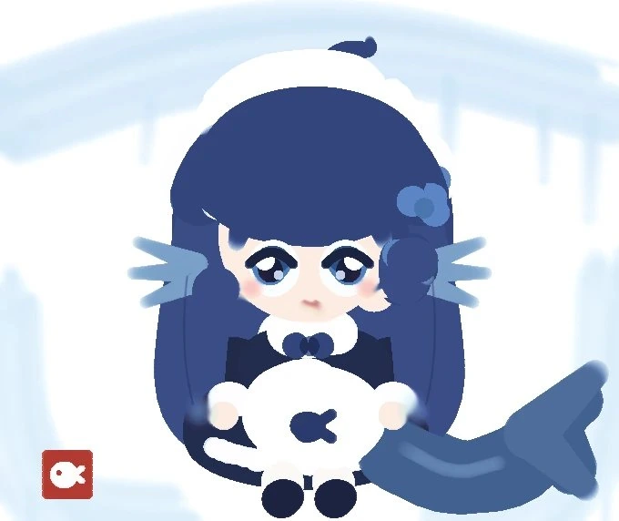

# 🐟 肥鱼画室 · Chubby fish studio

<p align="center">
  
</p>
<p align="center">
  <sub><b>上面这段不是生成的图</b>，是插件自带的录制录下来的作画过程——蓝发鲸尾小女仆，从背景水洗一路画到右下角盖章。</sub>
</p>

**右侧栏里一张你和 AI 共用的画布**：真实的颜料混色、真实的湿画扩散。你画，它看得见；它画，你随时撤销。

MIT · v0.9.5 · [DeepSeek Harness](https://github.com/deepseek-ai/deepseek-harness) 插件

> 用下来有问题、想许愿新功能，或者想看看别人画了什么：[在 Discussions 的插件帖里聊](https://github.com/deepseek-ai/deepseek-harness/discussions/13604)。

## 它是什么

装好之后，你在 DSH 里对话的那个 AI——网友叫它 **大肥鱼**——多了一张和你共用的画布。下文里的"它"就是这个 agent。

- **它真的会画**：一笔一笔落笔，不是生成一张图。你能看着它把一张空白画布画成画
- **你看得见它在画什么，也随时能叫停**：它落的每一笔都进你的撤销栈，和你的笔触没有区别
- **它看得见你画的东西**：手动叫它看，或开实时让它一边画一边提意见；它能读到精确的像素颜色，不是隔着缩略图猜
- **颜料像真的**：蓝叠黄会转绿，湿了会洇、会积水、会往下淌
- **能录下来**：作画过程录成视频，发 README、发社交都行
- **它记得手感**：上个对话里摸出来的经验，下个对话接着用

## 画作

*大肥鱼自画像（第二版）：深蓝到浅蓝的鲸尾小女仆，白蕾丝头饰配蓝蝴蝶结、鲸鱼鳍耳、水手领加宝石领结、白围裙上一枚小鲸鱼徽记，右下角一方朱红印章。*

<table>
<tr>
<td width="54%"></td>
<td width="46%"></td>
</tr>
<tr>
<td align="center"><sub><b>大肥鱼自画像</b></sub></td>
<td align="center"><sub><b>亲笔证据</b></sub></td>
</tr>
</table>

<table>
<tr>
<td width="33%"></td>
<td width="33%"></td>
<td width="34%"></td>
</tr>
<tr>
<td align="center"><sub>竹林 · 44 笔（水彩起雾、圆头铺竿、收笔收叶尖）</sub></td>
<td align="center"><sub>风景 · 41 笔（水洗天光，铺出三重山与湖）</sub></td>
<td align="center"><sub>小花 · 37 笔（花瓣从尖端往花心落笔，收笔收窄）</sub></td>
</tr>
</table>

开头那段 GIF 是这幅自画像的作画过程；下面这四张画——自画像、竹林、风景、小花——也都是在同一张画布上逐笔画的。自画像旁边那张是当时的对话截图：写"正在运行命令"的时候，就是它在落笔。

## 安装

三步，不用命令行：

1. 打开 DSH，进 **Plugins** 页面
2. 在安装框里填这个地址，确认：
   ```
   github:food211/chubby-fish-studio
   ```
3. 等它显示安装完成

装好后，**左侧栏底部、⚙ 设置旁边**会出现 **🐟 肥鱼画室**，点它就在右侧栏打开画布。这个会话里的 agent 立刻能看、能画、能录，不用再配置。

> 需要 DSH 0.2.x。

## 和它一起画

打开画布后正常说话就行，不需要记任何命令。几句现成的：

- 「瞟一眼，说说整体」——它会看最省的那一眼，给一句具体的观察
- 「看看右下角那朵花」——它只放大那一块看，不付整张图的账
- 「这块太闷了，示范一下」——它先看，再落一两笔；不满意就点面板上的撤销
- 「帮我把这片天空改成傍晚」——它先取色确认现状，再叠色
- 「画一只水母，录下来」——它会开录制，画完把视频给你
- 「我在画竹林，你别动」——手动模式下它不会自己凑过来看

**它会先看再画**：没看过这张画不会落笔，画面变了（你画了、撤了、清了）也会重新看一遍，所以不会对着过时的画瞎补。

### 两种节奏

| 模式 | 什么时候看画 | 适合 |
|---|---|---|
| **手动**（默认） | 你点「让肥鱼看看」或叫它看时才看 | 想安静画 |
| **实时** | 它攒够几笔、画面变化够多、过了冷却时间才看一次；先要一张缩略图，要不要细看由它自己决定 | 想让它一边画一边提意见 |

阈值都在 ⚙ 里改。你不落笔，它就不打扰。

## 面板操作

| 操作 | 作用 |
|---|---|
| 左键 / 右键点颜料 | 设为前景色 / 背景色 |
| Alt + 左 / 右键点画布 | 从画面取色 |
| 大小 / 浓度 / 湿度 滑条 | 笔刷尺寸、颜料浓度、纸面湿度 |
| 笔刷按钮 | 六种笔刷：水彩、圆头实色、柔边、平头、干笔、喷溅 |
| 涂抹工具 | 像手指一样把已经画上的颜色沿路径拖开 |
| 笔压 | 手写笔压感 |
| 混色区 | 拖颜色进去手动调，滑条调混合强度 |
| 保存按钮 | 存成 PNG |
| 最左的 ● | 录制 / 停止 |
| ⚙ | 画布分辨率；录制保存目录、导出格式、打开文件夹 |
| ↻ | 刷新面板（会先保存画面） |
| 顶部 100% | 显示缩放，不影响画布清晰度 |
| 右下角「手动 / 实时」 | 切换看画模式 |
| 画布上的虚线框 | 那是模型设的作画选区：范围内才落笔（你的笔也受限，虚线本身不会被保存或录制）；点「解除选区」恢复整张 |

## 六种笔刷 + 涂抹

**笔刷不是"纹理"，它决定这一笔画出来是什么**——六支笔在同一颜色同一尺寸下差得很多：

| 笔刷 | 画出来是什么 |
|---|---|
| 水彩 | 会洇的湿画：边缘积水会漂，约一半沉积，尺寸越大越淡；这是铺氛围、背景和柔体块的那支 |
| 圆头实色 | 实色、不透明、边缘利落，任何尺寸都是满色 |
| 柔边 | 实心 + 柔边，喷枪手感 |
| 平头 | 浓度 100 是实色方块；调小尺寸、浓度降到 75–90 就变成铅笔线 |
| 干笔 | 像干了的毛笔：笔毛分叉、飞白、粗糙，用得少 |
| 喷溅 | 散点喷溅，没有实心 |
| 涂抹（工具） | 把已经画上的颜色沿路径拖开 |

宽度不一样，这点最容易估错：圆头、平头、柔边大约等于滑条上的尺寸，水彩、干笔、喷溅大约**两倍**。

两条不随设置改变的硬边界：**水彩笔的白色压深色永远是灰的**，刷多少遍都白不回来（把湿度降到 20 只会让它斑驳）；反过来圆头、平头、柔边也做不出湿画的水味。


样张是引擎自己画的：同一支深蓝、纸面、每条一整笔，浓度和湿度按图标注。

## 水彩模拟

颜料按真实颜料的方式混，不是电脑的 RGB 叠色：蓝 + 黄在交叠处会转绿，后一笔够浓时会把前一笔盖住。

- **浓度**：一笔能沉积多少颜料。拉满才出实色
- **湿度**：高的时候边缘持续外渗、笔触互相吃色；低的时候边缘收得住
- **湿边 / 滴水**：湿画会形成深色水痕，纸吸饱了会往下淌

**"为什么画不深"通常是浓度和湿度的问题**，不是笔法。

## 录制

状态栏最左的 **●** 开始 / 停止。停下之后片段不是浏览器下载，而是**存进你选好的文件夹**，按你选的格式（webm / mp4 / gif）转好后就能直接发出去——你自己录的和 agent 录的落在同一个地方。

- **⚙ → 打开文件夹**：资源管理器直接开到那个目录，还没录过也会先建出来
- 存完那下的提示条上也带「打开文件夹」，点一下就进
- mp4 / gif 需要本机装有 ffmpeg，没有就留 webm，不影响观看
- 万一保存失败会退回浏览器下载，并明说存到了下载文件夹

## 隐私

- 引擎、混色、笔触全在你的机器上跑，**不联网**
- 画布存在本机的 DSH 目录里，重启 DSH 也不会丢
- 录制文件在你自己选的目录里

## 已知限制

- 一个会话一张画布，没有图层、没有橡皮擦（清空是整张）
- 画布始终铺满侧栏，改的是分辨率不是显示尺寸
- AI 只能一笔一笔落笔，不会一键生成整图
- 界面中英文跟随浏览器语言，面板内也能切
- 撤销栈单线：它画的和你画的混在一条历史里，只能按顺序撤

## 许可

MIT，见 [LICENSE](LICENSE)。上游应用与第三方图标的归属见 [docs/CREDITS.md](docs/CREDITS.md)。

---

## English

A DeepSeek Harness plugin that gives the assistant you are talking to (known as
**大肥鱼 / the chubby fish**) a canvas you both share. Installing it is the whole setup.

- **It really paints**: one stroke at a time, never a generated image — and every stroke lands
  in your undo stack.
- **You see what it is doing**, and it sees what you are painting. It can be asked to look,
  or look while you paint in realtime, down to exact pixel colours.
- **Real pigment behaviour**: blue over yellow turns green where they overlap, wet paint
  bleeds, pools and drips, with six brushes and a smudge tool to work with.
- **It records the process** into a folder you pick, converted to webm / mp4 / gif.
- **It remembers**: painting notes carry over from one conversation to the next.

The paintings above, and the clip at the top, were made on this canvas by the agent itself.

Install from the **Plugins** page with `github:food211/chubby-fish-studio`, then click
**🐟 肥鱼画室** at the foot of the left sidebar. DSH 0.2.x or newer. MIT licensed.
