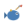

# 🐟 肥鱼画室 · Chubby fish studio

一个 [DeepSeek Harness](https://github.com/deepseek-ai/deepseek-harness) 插件：在右侧栏里和 AI **共用一张颜料混合作画布**。

不是"给 AI 一张图片"，而是同一支笔、同一套颜料引擎——你画的它能看见，它画的你能撤销。



## 有什么

- **真实的颜料混合**：自带 KM（Kubelka–Munk）混色引擎，蓝 + 黄真的会变成绿，而不是 RGB 平均。
- **水彩管线**：纸面湿度、颜料浓度、湿边扩散、滴水；笔刷有 `watercolor` / `dry` / `splatter` / `circle` / `soft` / `flat` 六种材质。
- **AI 能看**：`canvas_look` 把当前画面作为图片交给模型，附带画布尺寸、当前笔刷、调色板、撤销位置。
- **AI 能画**：`canvas_draw` 落笔，支持逐笔指定颜色 / 尺寸 / 浓度 / 湿度 / 笔刷材质，也可用涂抹工具；**每一笔都进你的撤销栈**。
- **AI 能取色**：`canvas_sample` 读画布真实像素（不是缩略图猜色），用来判断"这块到底多深"。
- **两种节奏**：手动（你说"看看"它才看）或实时（笔触攒够阈值后自动看一次，阈值可调）。
- **画布分辨率**：⚙ 里用滑条或直接输数字，480–1000 逻辑宽（680–1417 px 位图）。
- **不会因为重启而失忆**：每次快照落到 `<DSH_HOME>/canvas-state/`，重开 DSH 会自动把上一幅画灌回来。

## 安装

在 DSH 里打开 **Plugins** 页面，安装这个包：

```
github:food211/chubby-fish-studio
```

也可以把仓库克隆到本地，然后安装**目录**（绝对路径）：

```
git clone https://github.com/food211/chubby-fish-studio.git
# Plugins → 安装 → 填 <仓库绝对路径>
```

安装后在左侧栏底部、⚙ 设置旁边会出现 **🐟 肥鱼画室**，点它就在右侧栏打开画布。

> 需要 DSH 0.2.x。插件由 Host 一半（工具 + HTTP 桥）和浏览器一半（面板）组成，两者版本必须一致。

## 用法

| 操作 | 说明 |
|---|---|
| 左键 / 右键点颜料 | 设为前景色 / 背景色 |
| Alt + 左键 / 右键点画布 | 从画面取色 |
| ⚙ | 画布分辨率（滑条或数字） |
| ↻ | 刷新面板（会先保存画面），或重载整个界面 |
| 右下角状态 | 「手动」/「实时」——点一下切换 |
| 顶部 100% | 显示缩放（不影响画布分辨率） |

想让它看画，直接说：「看看我画的」；想让它示范，说：「在天空上补一笔湿的」。

## 数据落在哪

- 快照：`<DSH_HOME>/canvas-state/<sessionId>.json`（每个会话一个文件，**原地覆盖**）
- 保留策略：最多 16 个文件 / 30 天，单帧超过 4 MB 不落盘
- 面板自身的偏好（笔刷、调色板、画布尺寸）仍在浏览器 localStorage 里；插件会把上一帧写回 localStorage，所以端口变化也不会白板

## 从源码构建

`client.js` 是**预构建产物**，安装时不需构建。要自己重新生成，需要上游 Mixbox Palette 的源码（本仓库不分发）：

```bash
node build/build-client.mjs --src <上游源码目录>
# 或 MPX_SRC=<目录> node build/build-client.mjs
```

构建会逐文件注入并施加受断言保护的补丁：上游文件结构一旦变化就报错退出，不会静默产出坏包。

## 许可

MIT，见 [LICENSE](LICENSE)。上游应用与第三方图标归属见 [docs/CREDITS.md](docs/CREDITS.md)。

---

## English

A DeepSeek Harness plugin that puts a **pigment-mixing painting canvas** in the right
sidebar, shared with the agent.

- Real Kubelka–Munk pigment mixing, a watercolour pipeline (wetness, concentration,
  bleeding, drips) and six brush textures.
- The agent sees the canvas through `canvas_look`, paints with `canvas_draw`
  (per-stroke colour, size, strength, wetness, brush type, smudge, undo/redo/clear),
  and reads exact pixels with `canvas_sample`. Every agent stroke is undoable.
- The painting survives restarts: snapshots are written to `<DSH_HOME>/canvas-state/`
  and restored on the next launch.

Install from the **Plugins** page with `github:food211/chubby-fish-studio`, then click
**🐟 肥鱼画室** at the foot of the left sidebar. MIT licensed.
