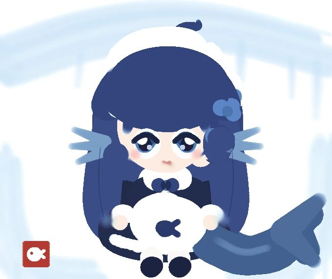
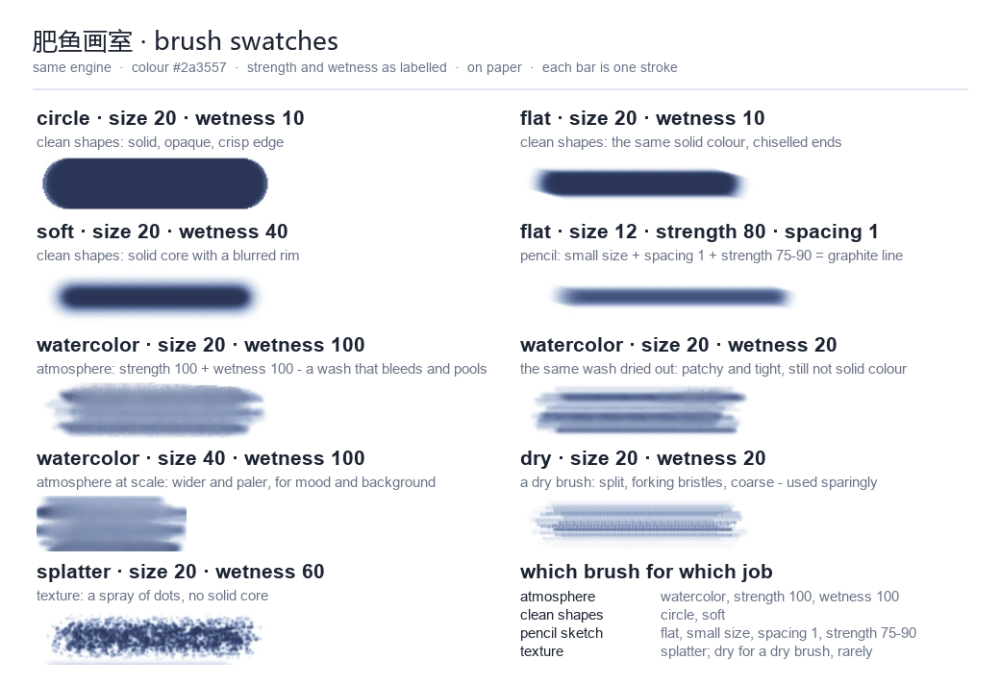

# 🐟 肥鱼画室 · Chubby fish studio

*大肥鱼自画像。约 180 笔，画在这个画布上：深蓝到浅蓝的鲸尾小女仆，白蕾丝头巾、蓝蝴蝶结、鲸鱼鳍耳，白围裙上一枚小鲸鱼徽记。左下角是朱红印章。*

<table>
<tr>
<td width="54%"></td>
<td width="46%"></td>
</tr>
<tr>
<td align="center"><sub><b>大肥鱼自画像</b></sub></td>
<td align="center"><sub><b>亲笔证据</b></sub></td>
</tr>
</table>

<table>
<tr>
<td width="33%"></td>
<td width="33%"></td>
<td width="34%"></td>
</tr>
<tr>
<td align="center"><sub>竹林 · 44 笔（<code>watercolor</code> 起雾、<code>circle</code> 铺竿、<code>taper</code> 收叶尖）</sub></td>
<td align="center"><sub>风景 · 41 笔（水洗天光，铺出三重山与湖）</sub></td>
<td align="center"><sub>小花 · 37 笔（花瓣从尖端往花心落笔，<code>taper</code> 收窄）</sub></td>
</tr>
</table>

上面四张画都是大肥鱼在画布里逐笔画的。右上那张是当时的对话截图——写"正在运行命令"的时候，就是 `canvas_draw` 在落笔。

**右侧栏里一张你和 AI 共用的画布**：真实的颜料混色、真实的湿画扩散。你画，它看得见；它画，你随时撤销。

MIT · v0.8.4 · [DeepSeek Harness](https://github.com/deepseek-ai/deepseek-harness) 插件

## 它是什么

装好之后，你在 DSH 里对话的那个 AI——网友叫它 **大肥鱼**——多了一张和你共用的画布。下文里的"它"就是这个 agent。

- **你画一笔**，它看得见：手动叫它看，或开实时让它自己看
- **它说一句**，然后直接在你的画上落一笔示范（不是生成新图）
- **不满意就撤销**：它落的每一笔都进你的撤销栈，和你的笔触没有区别
- **它能读像素**：精确读到 `#94364F`，不是隔着缩略图猜

## 安装

三步，不用命令行：

1. 打开 DSH，进 **Plugins** 页面
2. 在安装框里填这个地址，确认：
   ```
   github:food211/chubby-fish-studio
   ```
3. 等它显示安装完成

装好后，**左侧栏底部、⚙ 设置旁边**会出现 **🐟 肥鱼画室**，点它就在右侧栏打开画布。这个会话里的 agent 立刻能用下面四把工具，不用再配置。

> 需要 DSH 0.2.x。插件由 Host（工具 + 桥接）和浏览器（面板）两半组成，两者版本必须一致。
> 改源码的话，仓库就是上面那个地址，构建方式见文末。

## 一起画

打开画布后正常说话就行。这些工具只作用于当前会话的画布：

| 工具 | 它用来做什么 | 代价 |
|---|---|---|
| `canvas_glance` | **瞟一眼**：整张画缩成缩略图，看构图和大色块 | 最省 |
| `canvas_zoom` | **凑近看**：给两个 0–1 的比例点（`from [0.2,0.3]` 到 `to [0.45,0.55]`），面板裁出这两点围成的矩形放大 | 只付这一块 |
| `canvas_look` | **仔细看**：整张画原尺寸 + 像素尺寸、笔刷、调色板、颜色、撤销位置 | 最贵 |
| `canvas_state` | 只读状态，不传图 | 最便宜，但**不算看过** |
| `canvas_draw` | 落笔：多条笔触，每条可单独指定颜色、尺寸、**浓度**、**湿度**、**笔刷材质**、**压感曲线**，或用涂抹；也能 `undo` / `redo` / `clear` | — |
| `canvas_sample` | 读准确像素色值 | 一次几个点 |
| `canvas_brushes` | **笔刷样张**：一张由本引擎自己画出来的标注样张 + 每种笔刷一行说明；不占画布、不需要打开面板 | 一张图，可按需调用 |
| `canvas_tools` | **按需加载**：`canvas_guide` / `canvas_brushes` / `canvas_notes` / `canvas_sample` 这四个只在需要时才载入，平时不进请求的 schema | 一行 |
| `canvas_guide` | **画法指南**：构图、配色、从后往前的分层顺序、笔压收笔、自检、何时该重画；纯文字 | 读一次 |
| `canvas_notes` | 读写**画布记忆**：多篇 MD 的目录，先看索引再读某一篇 | 索引很省，按篇读 |

### 看三档，落笔前必须看过

- 先 `canvas_glance` 看布局，再用 `canvas_zoom` 抠细节，只在颜色和边缘真的要紧时才 `canvas_look` 付整张图的账。
- **`canvas_draw` 会拒绝落笔**：这个会话里还没看过整张画，或者上次看过之后画面又变了（用户画了、撤了、清空了、面板重载了），都会被打回，要求先看再画。它自己刚落下的笔触不算"变了"，所以能连着画。
- `canvas_state` 只报参数、不给画面，所以不满足这条规则。

坐标有两套，同一张画上通用：

- **画布像素**（默认）：和 `canvas_look` 报的尺寸一致
- **比例**：坐标全部落在 0–1 之间就自动按比例读，和 `canvas_zoom` 的 `from`/`to` 同一套——在缩略图上量到哪就写哪，不用换算。要强制时也可以写 `unit: "pixels"` / `"ratio"`

长路径还能写成一行字符串，比嵌套数组更难写坏：

```
"path": "0.36,0.60 0.37,0.65 0.40,0.70:0.4"
```

空格分词、逗号分坐标、冒号后面跟压感（可省）。一次调用最好只带 8 笔上下——调用越长越容易被流截断，断了整批都白画。

### 形状

铺色不必一行行刷，形状可以直接给：

```
"ellipse": [0.5, 0.33, 0.12, 0.11]        填一个椭圆，一笔，边是一条干净的弧
"ellipse": [0.5, 0.33, 0.12, 0.11], "ring": true     只描边
"ellipse": [0.5, 0.33, 0.12, 0.11], "from": 200, "to": 340   画一段弧
"polygon": [[0.36,0.52],[0.64,0.52],[0.68,0.74],[0.32,0.74]]  填一个多边形（host 切片成横带）
"mirror": "x"                              同一笔再镜像一次，左右对称的成对元素一笔搞定
```

椭圆是**从圆心往外绕的螺旋**，所以边缘平滑没有圆头帽的鼓包；`size` 同时决定间距，填满靠它。

### 曲线

一条弧不用铺一串点，`q`/`c` 后面给控制点就行：

```
"0.30,0.40 q 0.50,0.10 0.70,0.40"          一次贝塞尔弧（二次）
"0.20,0.60 c 0.30,0.20 0.60,0.20 0.80,0.60" 两个控制点（三次）
```

散点也会自动圆滑：三点以上默认走 Chaikin 细分，所以一撮头发、一条尾巴只要三四个点，不用自己插值。要保留尖角就写 `smooth: false`。

收尖不用手写压感数组，给一句 `taper: "out"` 就行——压力在最后 45% 上从 1 降到 0.3，配 `soft` 曲线。低压力**同时**让笔触变细和变淡，至于这读起来是"收尖"还是"发虚"，跟形状有关，值得试了再看，不用先下结论。

`size` 是笔触**从路径往两侧各铺多远**，所以一笔的宽度大约是它的两倍。

### 画布记忆：多篇 MD + 渐进加载

`<DSH_HOME>/canvas-notes/` 是一个小目录，一篇笔记一个主题（`brushes.md`、`composition.md`、`mistakes.md`……）。**不同会话共用**，所以上个对话摸出来的手感，下个对话直接继承。

不整份塞进上下文，按需加载：

| 动作 | 返回 |
|---|---|
| `canvas_notes`（默认 index） | 每篇一行：标题 + 首行 + 字数，连同总量占了多少 |
| `action: "read", file: "brushes"` | 只返回这一篇全文 |
| `action: "append", file, text` | 往某一篇追加一行；新文件名就是新建一篇 |
| `action: "replace"` / `"delete"` | 整篇重写 / 删掉一篇 |

预算：单篇 2400 字、整份 12000 字。**超了不收**，而是回一份清单（每篇多少字）让你自己收拾：合并讲同一件事的、删掉被推翻或过时的，用 `replace` 写回压缩版、`delete` 清掉该走的，再 `append` 那一条。

第一次调用会自动铺三篇种子笔记，之后就不再插手——你删掉哪篇都不会被重新种回来。

对话里可以这么说：

- 「瞟一眼，说说整体」→ 它用 `canvas_glance`，便宜
- 「看看右下角那朵花」→ 它用 `canvas_zoom`，只裁那一块
- 「看看我画的」→ 它 `canvas_look` 仔细看，给一句具体的观察
- 「这块太闷了，示范一下」→ 它先看一眼，落一两笔，你 `Ctrl+Z` 就撤掉
- 「帮我把这片天空改成傍晚」→ 它先取色确认现状，再叠色
- 「我在画竹林，你别动」→ 手动模式下不会有自动看画打断你

### 两种节奏

| 模式 | 什么时候看画 | 适合 |
|---|---|---|
| **手动**（默认） | 你点「让肥鱼看看」或叫它看时才看 | 想安静画 |
| **实时** | 笔触先进收件箱，攒够**笔数 / 像素变化 / 冷却时间**才看一次 | 想让它一边画一边提意见 |

三个阈值都在 ⚙ 里改。埋点按笔触发，不落笔就不打扰。

## 水彩模拟

### 颜料按 Kubelka–Munk 混

蓝 + 黄在交叠处会转绿——画布上量过：黄 `#E8B84A` 上叠蓝 `#2A4FD0`，交界处读出 `#688E6F`。像真颜料一样，后一笔浓度足够高时会把前一笔盖住（同一处中心读出 `#396992`）。引擎用预先烘好的 KM 查找表，落笔时按"当前浓度 + 纸面已有颜色"实时解算。

### 浓度和湿度决定沉积

- **浓度（1–100%）**：一笔能沉积多少颜料。拉满才出实色
- **湿度（0–100%）**：100% 时边缘持续外渗、笔触互相吃色；20% 时边缘收得住
- **湿边 / 滴水**：湿画会形成深色水痕，纸吸饱了会往下淌

**"为什么画不深"通常是浓度和湿度的问题**，不是笔法。具体数值和实测对照见 [docs/DETAIL.md](docs/DETAIL.md#浓度和湿度决定沉积)。

### 六种笔刷 + 涂抹

**先定用途，再选笔刷。** 笔刷不是"纹理"，它决定这一笔**画出来是什么**——这是落笔时最容易选错、也最贵的一步：

| 我想画 | 用哪支 | 设置 |
|---|---|---|
| 氛围、大色块、背景、柔的体块 | `watercolor` | 浓度 **100** + 湿度 **100**（面板默认就是） |
| 清晰造型、平涂、边缘利落 | `circle`、`soft` | 浓度 100；`soft` 的边缘是柔的，芯是实的 |
| 线稿、排线、草稿 | `flat` | **size 小** + **间距 1%**（`spacing: 1`）+ 浓度 **75–90**，出铅笔试的细线 |
| 喷溅、颗粒、星点 | `splatter` | 浓度 100 |
| 干毛笔的分叉、粗糙感（用得少） | `dry` | 浓度 100，低湿度 |

同色同尺寸下画出来差这么多：

| 笔刷 | 画出来是什么 | 宽度 |
|---|---|---|
| `circle` | 实色、不透明、边缘利落，任何尺寸都是满色 | ≈ 1×size |
| `flat` | 浓度 100 是实色方块；小 size + 间距 1% + 浓度 75–90 就变成铅笔线 | ≈ 1×size |
| `soft` | 实心 + 柔边，喷枪手感 | ≈ 1×size，外加晕开 |
| `watercolor`（湿 100） | 会洇的湿画：边缘积水会漂，约一半沉积，尺寸越大越淡 | ≈ 2×size |
| `watercolor`（湿 20） | 同色但干涩断续、边缘收得住——刻意的速写笔，不是"更实的平涂" | ≈ 2×size |
| `dry` | 像干了的毛笔：笔毛分叉、飞白、粗糙，用得少 | ≈ 2×size |
| `splatter` | 散点喷溅，没有实心 | ≈ 2×size 加散点 |
| 涂抹 | 把已经画上的颜色沿路径拖开 | 沿路径 |

两条不随设置改变的硬边界：**水彩笔的白色压深色永远是灰的**，刷多少遍都白不回来（把湿度降到 20 只会让它斑驳）；反过来 `circle` / `flat` / `soft` 也做不出湿画的水味。



样张是引擎自己画的（同一支深蓝、纸面、每条一整笔，浓度和湿度按图标注），右下角那张格子里写的就是上面这套配方。模型可以调 `canvas_brushes` 随时拿到这张图连同同一份表——所以它不用靠猜，也不用在你的画上试笔。

### 落笔逐帧推进

一条笔触摊在最多 16 帧（约 0.25 秒）里画完，笔与笔之间留 200 毫秒。所以你看到的是它一笔一笔落下来，而且每笔一个独立历史帧。

### 压感按曲线响应

默认不用压感：低压力同时也压低颜料沉积，同一只旋钮既让笔触变细也让颜料变薄。什么时候值得付这个代价，交给模型自己试——文档只把机制说清楚，不划范围。

| 曲线 | 映射 | 手感 |
|---|---|---|
| `linear` | `p` | 均匀 |
| `soft` | `p²(3−2p)` | 两端缓入缓出 |
| `firm` | `p^0.55` | 保宽后收，适合鳍和尾 |
| `ink` | `p^2.2` | 早收，像出锋 |

## 面板操作

| 操作 | 作用 |
|---|---|
| 左键 / 右键点颜料 | 设为前景色 / 背景色 |
| Alt + 左 / 右键点画布 | 从画面取色 |
| 大小 / 浓度 / 湿度 滑条 | 笔刷尺寸、颜料浓度、纸面湿度 |
| 笔刷按钮 | 六种材质切换 |
| 笔压 | 手写笔压感 |
| 混色区 | 拖颜色进去手动调，滑条调混合强度 |
| 保存按钮 | 存成 PNG |
| ⚙ | 画布分辨率：滑条或数字输入，480–1000 逻辑宽（680×572 – 1417×1192 px） |
| ↻ | 刷新面板（会先保存画面），或重载整个界面 |
| 顶部 100% | 显示缩放，不影响画布分辨率 |
| 右下角「手动 / 实时」 | 切换看画模式，点开时清空事件收件箱 |

## 数据在哪

- **画布快照**：`<DSH_HOME>/canvas-state/<sessionId>.json`，每个会话一个文件、原地覆盖
- **保留**：最多 16 个文件 / 30 天，单帧超 4 MB 不落盘
- **跨重启**：DSH 重启后端口会变（localStorage 按 origin 隔离），插件把上一帧写回，画不会丢
- **不联网**：引擎、混色表、笔触全在本地跑

## 从源码构建

`client.js` 是预构建产物，安装不需要构建。重新生成需要上游绘画应用的源码（本仓库不分发）：

```bash
node build/build-client.mjs --src <上游源码目录>
# 或 MPX_SRC=<目录> node build/build-client.mjs
```

构建逐文件注入并施加受断言保护的补丁：上游文件结构一变就报错退出。

## 已知限制

- 一个会话一张画布，没有图层、没有选区、没有橡皮擦（清空是整张）
- 画布始终铺满侧栏，改的是分辨率不是显示尺寸
- AI 只能一笔一笔落笔，不会一键生成整图
- 界面中英文跟随浏览器语言，面板内也能切
- 撤销栈单线：它画的和你画的混在一条历史里，只能按顺序撤

## 许可

MIT，见 [LICENSE](LICENSE)。上游应用与第三方图标的归属见 [docs/CREDITS.md](docs/CREDITS.md)。

---

## English

A DeepSeek Harness plugin that gives the assistant you are talking to (known as
**大肥鱼 / the chubby fish**) a canvas you both share. Installing it is the whole setup.

- **Real pigment mixing** through a Kubelka–Munk engine, a watercolour pipeline with
  concentration, paper wetness, wet edges and drips, six brush textures and a smudge tool.
- **Three ways to look, at three prices**: `canvas_glance` is a thumbnail of the whole
  canvas, `canvas_zoom` is one enlarged crop, `canvas_look` is the whole picture at full
  size. The agent is expected to spend the cheapest one that answers its question.
- **No painting blind**: `canvas_draw` refuses strokes until the agent has looked at the
  canvas in that session, and refuses again if the picture changed since that look (the
  user painted, undid, cleared, or the panel reloaded) — so a stale picture can never be
  painted over by accident.
- **The agent paints on your canvas, itself.** The paintings above were made stroke by
  stroke through `canvas_draw`; `canvas_look` shows it the picture and `canvas_sample`
  reads exact pixels. Every agent stroke lands in your undo stack.
- **Two tempos**: manual, or realtime where stroke events queue in an inbox and trigger a
  look only once the stroke count, pixel-change and cooldown thresholds are met.
- **Survives restarts**: snapshots live in `<DSH_HOME>/canvas-state/` and are restored on
  the next launch, even though the GUI port changes between runs.

Install from the **Plugins** page with `github:food211/chubby-fish-studio`, then click
**🐟 肥鱼画室** at the foot of the left sidebar. MIT licensed.
