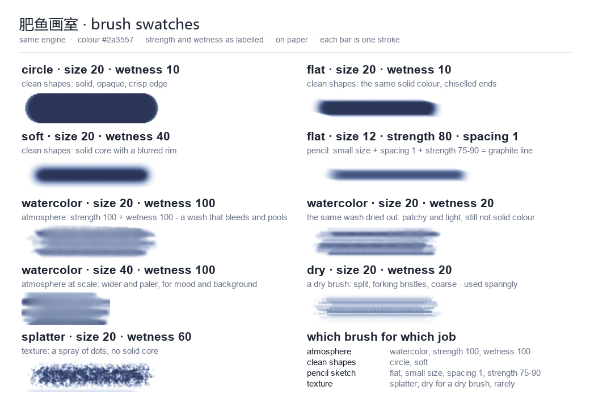

# 肥鱼画室 · Chubby fish studio

右侧栏里一张**你和 agent 共用的颜料画布**：真实的 Kubelka–Munk 混色、湿画扩散、六种笔刷；agent 看得见你的画，也能自己落笔，而它落的每一笔都进你的撤销栈。

**这是开发文档**：写给要看实现、或要改这个插件的人。面向用户的说明在仓库 README，插件市场里的详情页只是一张预览图（`docs/DETAIL.md`）。

## 面板这边

- **入口两处**：左侧栏底部、⚙ 设置旁边的常驻入口（宽栏显示「🐟 肥鱼画室」，收起成 56px 轨道时只剩图标）；以及右侧栏的 `chubby-fish-canvas` 标签类型 + 引导卡片。
- **颜料引擎**：自写的 KM（Kubelka–Munk）混色，32×32×320 的光谱查找表在 WebGL2 里采样；颜料按浓度沉积，纸按湿度扩散，边缘会积水、会往下淌。
- **六种笔刷**：`watercolor` / `dry` / `splatter` / `circle` / `soft` / `flat`；另有涂抹（沿路径把已画的颜色拖开）。
- **笔的参数**：大小、浓度（1–100）、湿度（0–100）、笔压（可开），混色区可手动调色。
- **画布分辨率**：⚙ 弹窗里用滑条或数字输入，480–1000 逻辑宽（680×572 – 1417×1192 px）。它改的是**位图分辨率**，不是显示尺寸；面板永远铺满侧栏，不随窗口缩放。
- **撤销 / 重做 / 保存 PNG / 显示缩放 / 中英切换**：面板自带。

## agent 这边

| 工具 | 能力 |
|---|---|
| `canvas_look` | 画面（图片块）+ 像素尺寸 + 当前笔刷/调色板/颜色 + 撤销位置；必要时附缩放提示 |
| `canvas_glance` / `canvas_zoom` | 缩略图 / 指定矩形放大，占画布前的两档便宜看 |
| `canvas_state` | 同样的状态，不带图，省 token |
| `canvas_draw` | 多条笔触；每条可单独指定颜色、尺寸、**浓度**、**湿度**、**笔刷材质**、**压感曲线**，或用涂抹；另有 `undo` / `redo` / `clear` |
| `canvas_sample` | 读画布**真实像素**（面板端 `readPixelByte`），用来判断"这块到底多深" |
| `canvas_brushes` | **笔刷样张**：`docs/brushes.png`（引擎自己画的标注样张）+ 每种笔刷一行说明；不占画布、不需要打开面板 |
| `canvas_tools` | **按需加载**：`canvas_brushes` / `canvas_notes` / `canvas_sample` 用 `register(def, { when })` 注册，未加载时连 schema 都不进该 step，加载后下一个 step 才可用 |
| **`canvas-studio` 技能** | 画室的说明书：`skills/canvas-studio/SKILL.md` 只有索引和硬规则，画法/工具/参数/录制/选区/坑各一篇放 `references/`，按需读。用 `ctx.skills.register()` 注册，`modelInvocable` 和 `userInvocable` 都开 |
| `canvas_notes` | 共享画布记忆：多篇 Markdown，先索引再按篇读 |

落笔走的是和手画完全相同的 `drawBrush` 管线；区别只在坐标系：agent 传的是画布像素坐标。

## 笔刷不是纹理，是"这一笔画出来是什么"

**先定用途，再选笔刷：**

| 用途 | 笔刷 | 设置 |
|---|---|---|
| 氛围、大色块、背景、柔的体块 | `watercolor` | 浓度 100 + 湿度 100（面板默认） |
| 清晰造型、平涂 | `circle`、`soft` | 浓度 100；`soft` 芯实边柔 |
| 线稿、排线 | `flat` | size 小 + 间距 1%（`spacing: 1`）+ 浓度 75–90，像铅笔 |
| 喷溅、颗粒、星点 | `splatter` | 浓度 100 |
| 干毛笔的分叉、粗糙感（用得少） | `dry` | 浓度 100、低湿度 |

同一种颜色（`#2A3557`）、`size` 20，画出来差这么多（浓度/湿度按样张标注，水彩笔用面板自己的默认 100/100）：

| 笔刷 | 落笔画出的像素 | 读作 |
|---|---|---|
| `circle` | `#2A3557` | 满色、实心、边缘利落（任何尺寸都满色） |
| `flat`，浓度 100 | `#2A3557` | 满色平涂，收笔更方更利 |
| `flat`，小 size + 间距 1% + 浓度 75–90 | 一条连续的灰线（样张那条：size 12 / 浓度 80 / 间距 1） | 石墨铅笔线，适合线稿排线 |
| `soft` | `#2A3557`（中心） | 满色，边缘柔到晕开，喷枪手感 |
| `watercolor`，湿 100 | `#8897B8` | 会洇的湿画：边缘积水、会漂，约五成沉积，尺寸越大越淡 |
| `watercolor`，湿 20 | `#B2C0D8` | 同色但干涩断续，边缘收得住——刻意的干笔速写，不是"更实的平涂" |
| `dry` | `#ABB9D4` | 约三成，断成干丝、留白飞白；像干了的毛笔，笔毛分叉，用得少 |
| `splatter` | `#52638D`（点心上） | 散点喷溅，没有实心 |

宽度也不一样：`watercolor` / `dry` / `splatter` 的 `size` 近似半径（宽度≈2×size），`circle` / `flat` / `soft` 的宽度≈1×size。

两条不随设置改变的硬边界：

- **水彩笔的白色压深色永远是灰的**，刷多少遍都不会白回来（这是真水彩的物理，不是 bug）；把湿度降到 20 只会让它斑驳，不会变成实色。
- 反过来 `circle` / `flat` / `soft` 也做不出湿画的水味——氛围感只能靠水彩。

所以「改已经画过的地方、白压深、要干净边缘」用 `circle`/`flat`/`soft`，「氛围、头发高光、纸纹、喷溅」用 `watercolor`/`dry`/`splatter`，「线稿」用低浓度小尺寸的 `flat`。



样张是引擎自己画的，由 `canvas_brushes` 直接交给模型；`index.js` 的 system prompt 里也写明了同一条结论，并让它在开画前先看一眼样张，而不是靠猜、也不是在你的画上试笔。

压感按**曲线**响应（`pressureCurve`）：`linear` / `soft`（smoothstep，两端缓）/ `firm`（保宽后收）/ `ink`（早收，像出锋）。默认不放压感——因为低压力同时压低沉积，整幅画都用压感会又淡又薄；收尖只该用在须、鳍尖、线尾这类地方。

## 浓度和湿度决定沉积

- **浓度（1–100%）**：一笔能沉积多少颜料，拉满才出实色
- **湿度（0–100%）**：100% 时边缘持续外渗、笔触互相吃色；20% 时边缘收得住
- **湿边 / 滴水**：湿画会形成深色水痕，纸吸饱了会往下淌

三种设置下的实测（水彩笔，画布像素直接读出）：

| 画进去 | 实际像素 | 说明 |
|---|---|---|
| `#C9525F`，浓度 77 / 湿度 100 | `#E58899` | 只沉积约六成 |
| `#9C2542`，浓度 100 / 湿度 40 | `#94364F` | 几乎原色 |
| `#9C2542`，浓度 20 / 湿度 40 | 几乎读不到红色 | 只是薄薄一层染色 |

同一组结论也写进了给 agent 的说明书（`index.js` 的 system prompt）：**深度靠浓度和叠第二遍，不靠湿度**；湿度管的是边缘走多远——要收形降湿度，要加深升浓度。

## 数据怎么走

**看**：面板把画布缩到长边 ≤900 px、webp 0.92 → `POST /mpx/canvas/push` → 宿主内存 + （600 ms 防抖）落盘到 `<DSH_HOME>/canvas-state/<sessionId>.json` → `canvas_look` 把它作为图片附件交给模型。

**画**：工具调用 → 宿主通过 SSE `GET /mpx/canvas/stream` 下发 `ops` → 面板逐笔落笔（一笔最多摊 16 帧，笔间留 200 ms，每笔一个独立历史帧）→ 面板 `POST /mpx/canvas/done` 回执，工具才返回，所以紧接着的 `canvas_look` 看到的是成品而不是半截。

**问**：`POST /mpx/canvas/ask` 把「面板问题 + 当前画面」作为一条用户消息投给会话。

**取色**：`canvas_sample` 走 `/mpx/canvas/sample`——宿主下发 `sample` op，面板读像素后回传，因为只有面板拿得到精确像素。

## 两种看画节奏

- **手动**（默认）：只有你点「让肥鱼看看」或直接叫它看。
- **实时**：笔触事件先进收件箱，攒够**笔数 / 像素变化 / 冷却时间**三个阈值才触发一次（都能在 ⚙ 里调）。埋点是按笔的，不落笔就不打扰。

每次自动看画都会把最新快照推给宿主，所以即便在实时模式下，模型看到的也是刚画的。

## 会话与存储

- 画布按**会话**隔离：面板的 localStorage 键带 `mpx:<sessionId>:` 前缀，宿主的快照文件按 sessionId 命名。
- 落盘保留：最多 16 个文件 / 30 天，单帧超 4 MB 不落盘；每个文件原地覆盖，画得越久文件不会越大。
- **跨重启不丢**：DSH 每次启动端口会变（浏览器 localStorage 按 origin 隔离），所以挂载时若本 origin 没有存档，面板会 `GET /mpx/canvas/last` 把宿主那帧写回 localStorage 再启动；宿主重启后也会从盘上懒加载。

## 已知限制

- **一次一张画布**：一个会话一张，没有图层、没有选区、没有橡皮擦（清空是整张）。
- **撤销是单线的**：它画的和你画的混在同一条历史里，只能按顺序撤；它在落笔中途你按撤销，会让后面的帧被当作重做分支丢弃。
- **快照是拉取的**：模型只在工具运行时才"看"，不能边画边盯；每次看画消耗一张图。
- **只有 KM 引擎**：上游应用里基于 npm `mixbox` 的那个引擎、桌面宿主桥、更新器、公告弹窗都不在包里。
- **面板不跟随宿主主题**：作画面保持应用自己的深色面板样式；文字语言用应用自己的中英切换。
- **桥是本地环回 HTTP**：路由只在本机 GUI origin 下可达，没有额外鉴权。

## 重新构建客户端

`client.js` 是预构建产物，安装不需要构建。要重新生成需要上游绘画应用的源码（本仓库不分发）：

```sh
node build/build-client.mjs --src <upstream checkout>
```

脚本逐文件注入并施加受断言保护的补丁：上游文件结构一变就报错退出，不会静默产出坏包。

## 自检

改完元数据、文案或落笔参数后跑一遍：

```sh
node scripts/check.mjs          # 或 pnpm check / npm run check
node scripts/check.mjs locale   # 只跑一组：package / locale / skill / draw
```

| 组 | 查什么 |
|---|---|
| `package` | 官方包契约：manifest、补丁行、locale 元数据、详情页一张图、图标、Host 导出、`files` 覆盖 |
| `locale` | 面板文案是否全部走 Client locale 服务：每个 `t()` 键都有中文、没有多余译文、没有残留的 `L()`/`withLang`/`navigator` |
| `skill` | `canvas-studio` 技能能正常注册，索引里点名的每个 `references/*.md` 都存在且有内容 |
| `draw` | 参数合法化：比例越界、数值越界、像素坐标、填充路径、压感——都不许失败或画到看不见的地方 |

这些脚本只读仓库、不碰运行中的应用；`draw` 那组用一条假的 SSE 面板和真实的 ack 路由，所以不需要打开画室。

## English summary

A shared painting canvas between you and the agent. The panel hosts a custom
Kubelka–Munk pigment engine with a watercolour pipeline and six brush textures; the agent
gets `canvas_look`, `canvas_state`, `canvas_draw` (per-stroke colour, size, concentration,
wetness, brush texture, pressure curve, smudge, undo/redo/clear), `canvas_sample`
(exact pixels) and `canvas_brushes` (a labelled swatch sheet painted by the engine, plus
one line per brush — `circle`/`flat`/`soft` are opaque, `watercolor`/`dry`/`splatter` are
not). Strokes are paced across frames and acknowledged, so a tool call returns
only once the canvas really shows the finished stroke. Snapshots persist to
`<DSH_HOME>/canvas-state/` and are restored on the next launch.
